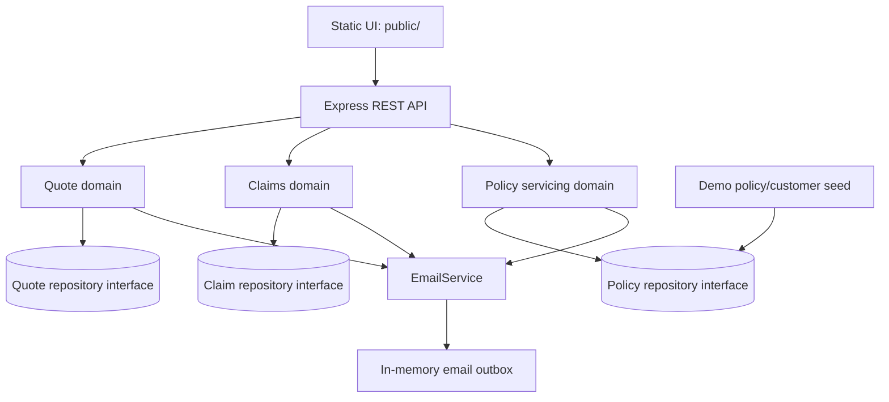

# Architecture

Single-process Node.js + TypeScript demo. Express routes validate HTTP input and delegate to domain functions/services; repositories are in-memory interfaces with demo implementations. No database or external email provider is contacted.

## Data flow

1. `src/app.ts` constructs repositories/services and mounts routes; `src/server.ts` binds the app to `PORT` (default 4000).
2. Zod schemas reject malformed request data. Domain functions enforce eligibility, pricing, claims lifecycle, beneficiary shares, trust and cooling-off rules.
3. Repository interfaces isolate storage from domain behavior. Maps reset on process restart; seed policies are loaded at startup.
4. Emails are recorded by `EmailService` and exposed at `GET /api/outbox`.

## Integration boundaries / future stubs

- **Email:** `EmailService` is the integration seam; only `InMemoryEmailService` exists. No real messages are sent.
- **Payments:** no payment/refund provider is implemented; cancellation and switch responses report a calculated refund only.
- **Underwriting:** pre-existing conditions route to `REFERRAL`; a future underwriting adapter could receive referral cases. No external decision is made.
- **IPL (illustrative integration placeholder):** no insurer/product-line integration exists; add a typed adapter when the target IPL contract is known.
